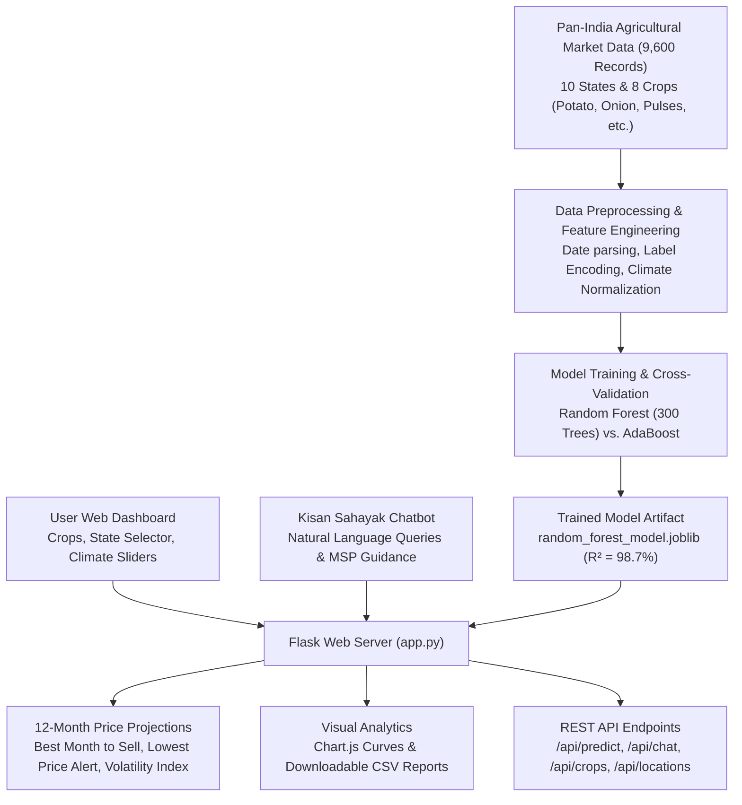

# 🌾 AgriPrice AI: Pan-India Crop Price Forecasting & Kisan Sahayak Chatbot

[](https://www.python.org/)
[](https://flask.palletsprojects.com/)
[](https://scikit-learn.org/)
[]()
[]()
[]()

> **A Pan-India AI-driven agricultural decision support platform featuring an Intelligent Agricultural Chatbot (Kisan Sahayak) and 12-month market price forecasting for essential staple crops (Potato, Onion, Pulses, Rice, Maize, etc.) across major agricultural States of India.**

---

## 📌 1. Project Overview & Motivation

Agricultural commodity markets across India experience sharp seasonal price swings. Farmers often suffer losses due to **post-harvest distress selling** during arrival gluts when prices are lowest.

**AgriPrice AI** empowers farmers and agricultural stakeholders with:
1. **12-Month Market Forecasts:** Monthly farm-gate and APMC Mandi rate predictions in **₹ / kg** and **₹ / Quintal** (1 quintal = 100 kg).
2. **Featured Essential Commodities:** **Potato (Alu)**, **Onion (Pyaz)**, and **Pulses (Dal/Gram)** as primary staples, alongside Rice, Maize, Chilli, Groundnut, and Sugarcane.
3. **State-Level Pan-India Intelligence:** Tailored to **10 major agricultural States of India** (Maharashtra, Uttar Pradesh, Madhya Pradesh, Punjab, Karnataka, Gujarat, West Bengal, Rajasthan, Bihar, Andhra Pradesh).
4. **🤖 Kisan Sahayak AI Chatbot:** An integrated conversational agent answering queries on real-time price trends, optimal selling timing, pest management, and Government MSP schemes.

---

## 🏗️ 2. System Architecture



---

## 📊 3. Machine Learning Evaluation (Pan-India Dataset)

Trained and cross-validated on **9,600** historical market records (2019–2023) across major APMC Mandis:

| Model | Hyperparameters / Setup | R² Score | RMSE (₹/kg) | MAE (₹/kg) | Status |
| :--- | :--- | :---: | :---: | :---: | :---: |
| **Random Forest Regressor** | `n_estimators=300, max_depth=10, min_samples_leaf=4, min_samples_split=10` | **0.9874 (98.7%)** | **₹4.23** | **₹2.96** | **Selected Best Model** |
| **AdaBoost Regressor** | `n_estimators=50, learning_rate=1.0` | 0.9224 (92.2%) | ₹10.48 | ₹8.90 | Baseline |

---

## 🌾 4. Featured Crops & States of India

### 🥔 Featured Focus Crops
- **Potato (Solanum tuberosum):** Major producing states: Uttar Pradesh (Agra belt), West Bengal, Punjab, Bihar, Gujarat. High post-harvest arrivals in Feb–April; peak selling realisations in Sept–Nov.
- **Onion (Allium cepa):** Major producing states: Maharashtra (Nashik/Lasalgaon), Karnataka, Gujarat, MP. High price volatility with peaks in Sept–Nov before Kharif crop arrivals.
- **Pulses (Tur, Chana, Moong):** Major producing states: Madhya Pradesh, Maharashtra, Rajasthan, Karnataka, UP. High protein cash legumes with designated NAFED MSP procurement.
- **Other Major Crops:** Rice (Paddy), Maize (Corn), Chilli (Mirchi), Groundnut (Peanut), Sugarcane.

### 🏛️ Covered States of India & APMC Mandi Hubs
- **Maharashtra:** Lasalgaon Mandi, Nashik (Asia's premier onion hub) / Pune APMC
- **Uttar Pradesh:** Agra Mandi (India's potato capital) / Kanpur Grain Mandi
- **Madhya Pradesh:** Indore Grain & Pulse Mandi / Ujjain APMC
- **Andhra Pradesh:** Guntur Mirchi Yard / Vijayawada Regional APMC
- **Punjab:** Jalandhar Potato Mandi / Ludhiana Grain Market
- **Karnataka:** Hubballi APMC / Gulbarga (Kalaburagi) Tur Mandi
- **Gujarat:** Rajkot APMC / Deesa Potato Market / Mahuva Onion Mandi
- **West Bengal:** Hooghly Potato Mandi / Siliguri Regulated Market
- **Rajasthan:** Jaipur Grain Mandi / Bikaner Dal & Pulse Yard
- **Bihar:** Gulab Bagh Mandi, Purnea / Patna APMC

---

## 🤖 5. Kisan Sahayak AI Chatbot Features

The system includes an integrated Conversational AI Assistant accessible via:
1. **Floating Chat Widget:** Available on every page in the bottom-right corner.
2. **Dedicated Chatbot Page:** Accessible at `/chatbot`.
3. **Conversational Capabilities:**
   - 📈 **Instant Price Forecasts:** *"What will be the price of potato in UP?"*, *"When to sell onion in Maharashtra?"*
   - 📦 **Storage & Post-Harvest Advice:** Cold storage temperature parameters (2–4°C for potato), curing methods to prevent onion bulb rot.
   - 🏛️ **MSP & Govt Schemes:** Current MSP for Pulses (Tur: ₹7,550/q, Chana: ₹5,440/q, Moong: ₹8,682/q), PM-KISAN, PMFBY crop insurance.
   - 🌾 **Agronomic Guidelines:** Soil types, sowing dates, and water requirements.

---

## 💻 6. Quickstart & Installation

```bash
# 1. Install dependencies
pip install -r requirements.txt

# 2. Run automated test suite (12 unit tests)
python test_app.py

# 3. Start the application
python app.py
```
Open **`http://127.0.0.1:5000`** in your browser.

---

## 🌐 7. REST API Endpoints

- `POST /api/predict`: Returns 12-month price predictions, KPIs, and volatility for given crop and state.
- `POST /api/chat`: JSON conversational endpoint for chatbot queries.
- `GET /api/crops`: List of supported crops and agronomic specifications.
- `GET /api/locations`: List of Indian States and default climatic norms.
- `GET /api/metrics`: ML model evaluation metrics (R², RMSE, MAE).
- `GET /api/health`: System health status check.

---

## 📁 8. Project Structure

```
Crop-Price-Prediction-Minor-Project-main/
│
├── app.py                      # Flask web application & REST API
├── agri_chatbot.py             # Kisan Sahayak Chatbot conversational engine
├── train_model.py              # ML training and evaluation script
├── test_app.py                 # Automated unit tests (12 tests)
├── generate_pan_india_dataset.py # Pan-India dataset generator
├── crops_dataset.csv           # 9,600 Pan-India market records
├── random_forest_model.joblib  # Trained Random Forest Regressor (R² = 98.7%)
├── model_metrics.json          # Serialized metrics and feature importances
├── requirements.txt            # Python dependencies
│
├── static/
│   ├── style.css               # Agricultural design & chatbot styles
│   ├── Potato.png              # Potato icon
│   ├── Onion.png               # Onion icon
│   ├── Pulses.png              # Pulses icon
│   ├── Rice.png, Maize.png...  # Crop icons
│   └── farmer.png              # Hero illustration
│
└── templates/
    ├── index.html              # Main dashboard with crop & state selector
    ├── result.html             # Forecast results with KPIs & Chart.js
    ├── chatbot.html            # Dedicated Kisan Sahayak AI Chatbot
    └── about.html              # System architecture & documentation
```
